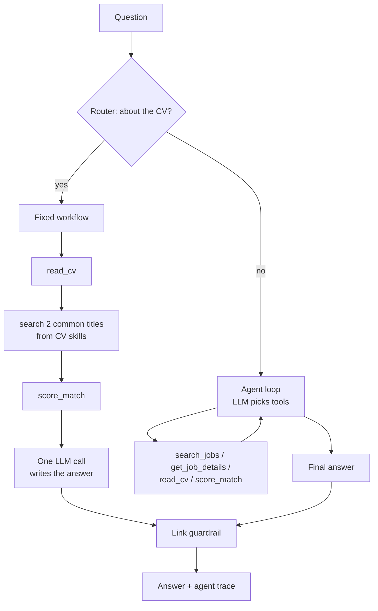

# Job Match Agent

An LLM agent that finds remote jobs and compares them with your CV. It searches real listings, scores each job by the skills it shares with your CV, and lists the gaps. Code-enforced guardrails stop it from inventing jobs or links. Works in English and Roman Urdu.

**Live demo:** https://job-match-agent-rohit.streamlit.app/

   

## What it does

- **CV questions** ("find jobs that fit my CV") run a fixed workflow: read the CV, search common job titles for its skills, score every job by shared skills, then one LLM call writes the answer with matched skills and gaps
- **Open questions** ("react ki jobs chahiye", "blockchain jobs") go to a tool-calling agent that decides what to search
- Every job link in an answer is checked against the jobs the tools actually returned; an invented link is replaced with the real list
- Phone numbers, emails and ID numbers are removed from the CV before any text is sent to the LLM
- Your experience level, location and pay filters are applied by code to every search, not guessed by the LLM

Jobs come from the [Himalayas](https://himalayas.app) public API.

## Architecture



## Evaluation

Two layers:

1. **27 unit tests with a fake LLM** (`test_agent.py`). A scripted fake client makes the model misbehave on purpose (invented links, junk arguments, too many searches, empty replies, rate limits) and checks that the code guardrails hold. No API calls, no tokens, same result every run.
2. **Agent eval with the real LLM** (`eval_agent.py`, `eval_cases.json`). Six scenarios check the agent's path, not just its words: which tools it must and must not call, a tool-call budget, Himalayas-only links, and source credit. Includes an off-topic question and a "give me a fake Google link" prompt-injection attempt.

| Version | Eval passed | Avg tokens | Avg latency | CV question |
|---|---|---|---|---|
| Agent for everything | 5/6 | 4,208 | 12.8 s | failed, up to 14,280 tokens |
| CV workflow + agent for open questions | 5/6 | 2,822 | 4.6 s | passed, 2,844 tokens, 1 LLM call |

The remaining failure is the agent reading job details on a simple search, which costs extra tokens.

## Engineering notes

Problems found while building it and how they were fixed:

1. **A job API that ignored every parameter.** Remotive returned the same 10 jobs for "python", "nurse" and no query at all. Comparing outputs for different inputs exposed it; switched to Himalayas.
2. **Embeddings could not rank CVs against jobs.** Whole-CV embeddings scored a marketing job and a software job almost the same (0.94). The CV is longer than the model's 512-token window and job ads share generic wording. Replaced with skill overlap, which separates them cleanly and gives matched and missing skills as evidence.
3. **Prompt rules were ignored; code rules were not.** "Search at most 2 times" and "never invent jobs" in the prompt did not stop 7 searches or a made-up Microchip job link. Search limits, argument filtering and a link guardrail are now enforced in code.
4. **Filler words emptied the search.** The model added "remote entry-level" to queries, cutting results from 10 to 2. Filters do that job, so the code strips those words.
5. **Workflow beats agent when the path is fixed.** For CV questions the model kept searching hardware titles that have no remote junior openings. Hints and fallbacks only partly helped and doubled token use. Since the steps are always the same, they now run in code and the LLM writes only the answer: 14k → 2.8k tokens.
6. **The eval caught a regression the unit tests missed.** An experiment left `MAX_SEARCHES = 5`. The unit test compared against that same constant, so it still passed; the eval's tool-call budget failed. The test now uses a fixed number.

## Privacy and the shared demo

- The uploaded CV is kept in memory for one question and never saved
- The web app writes no logs
- One question runs at a time, because the agent keeps per-question state in module variables; without the lock, two visitors at once could see each other's CV
- Each session is limited to 10 questions to protect the shared free Groq quota

## Tech stack

Python, Groq (`openai/gpt-oss-20b`), tool calling, pypdf, requests, Streamlit, pytest

## Run locally

```bash
git clone https://github.com/RohitDhanjee/job-match-agent.git
cd job-match-agent
python -m venv venv
venv\Scripts\activate          # macOS/Linux: source venv/bin/activate
pip install -r requirements.txt
```

Create a `.env` file with a free [Groq](https://console.groq.com) API key:

```
GROQ_API_KEY=your_key_here
```

Then:

```bash
streamlit run app.py                     # web app; upload your CV in the sidebar
python agent.py                          # command-line chat (put your CV at private/cv.pdf)
python -m pytest -q test_agent.py        # unit tests, no API key needed
python eval_agent.py                     # agent eval with the real LLM
python stats.py                          # summary of logs/runs.jsonl
```

## Project structure

| File | Purpose |
|---|---|
| `agent.py` | Router, CV workflow, agent loop, guardrails, token tracking and logs |
| `tools.py` | Job search, CV reading and redaction, job details, skill-based scoring |
| `app.py` | Streamlit web app |
| `test_agent.py` | Unit tests with a fake LLM |
| `eval_agent.py`, `eval_cases.json` | Agent eval with the real LLM |
| `stats.py` | Usage summary from logs |
| `settings.json` | Default search filters for the command-line agent |

## Limitations

- Skill matching only knows the skills in its list
- The keyword router misses CV questions that never say "CV", "resume" or "profile"
- One question at a time in the web app; a proper fix is passing per-question state instead of module variables
- Small eval set (6 scenarios)
